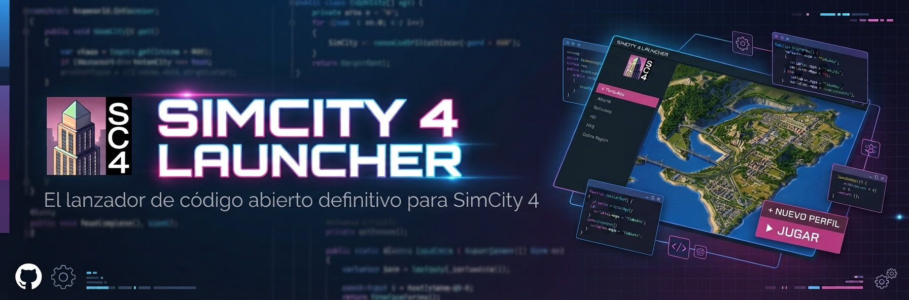

# SimCity 4 Launcher

Una forma sencilla de elegir cómo quieres iniciar SimCity 4. Crea perfiles para distintas partidas o configuraciones, ponles un fondo propio y abre el juego con un clic.

Necesitas Windows y una copia de SimCity 4 ya instalada. El launcher está en beta y no incluye el juego.

## Descargar e instalar

1. Abre la página de [versiones beta](https://github.com/fadrian06/SimCity-4-Launcher/releases) y descarga el ZIP de la versión más reciente.
2. Extrae **todo** el contenido del ZIP en una carpeta de tu elección. No ejecutes el launcher desde dentro del ZIP ni muevas el `.exe` por separado: necesita los demás archivos que vienen junto a él.
3. Abre `SimCity 4 Launcher.exe` desde esa carpeta.

## Crear tu primer perfil

1. Pulsa **Nuevo perfil**.
2. Cuando se te pida, busca y selecciona `SimCity 4.exe` dentro de la carpeta donde instalaste el juego.
3. Elige el perfil en la lista y pulsa **Jugar**.

El launcher recuerda el último perfil que seleccionaste. Puedes crear varios para tener a mano distintas formas de iniciar el juego.

## Administrar perfiles y fondos

- Para editar o eliminar un perfil, pasa el cursor sobre él y pulsa el botón de tres puntos que aparece.
- En **Editar perfil** puedes cambiar sus datos y elegir una imagen de fondo. Se admiten imágenes PNG, JPG, BMP, GIF, TIFF y WebP.
- Eliminar un perfil solo lo quita del launcher; no desinstala el juego ni borra tus ciudades guardadas.
- Los perfiles guardan la configuración de inicio que les hayas asignado. No son copias de seguridad de tus ciudades.

El launcher copia los fondos elegidos a su propia carpeta. Mantén juntos los archivos extraídos y no borres las carpetas `Profiles` o `Backgrounds` si quieres conservar tus perfiles e imágenes.

## Actualizar

Al abrirse, el launcher comprueba en GitHub si hay una beta más reciente (como máximo una vez cada 24 horas). Si la encuentra, te pregunta antes de descargarla. Al aceptar, verifica el archivo, instala la actualización y vuelve a abrirse; tus perfiles y fondos se conservan.

También puedes actualizarlo manualmente descargando el ZIP nuevo, cerrando el launcher y extrayendo todo en la misma carpeta. Acepta reemplazar los archivos de la aplicación, pero no elimines tus carpetas `Profiles` y `Backgrounds`.

## Privacidad

Tus perfiles y fondos se guardan en tu equipo: no se incluyen en el ZIP de descarga ni se envían a GitHub. Para buscar betas nuevas, el launcher consulta la información pública de versiones de GitHub; solo descarga archivos si aceptas la actualización. SimCity 4 y tus partidas siguen siendo tuyos; el launcher no incluye el juego.

## ¿Necesitas ayuda?

- Si no aparece ningún perfil, pulsa **Nuevo perfil** y selecciona `SimCity 4.exe`.
- Si el juego no se abre, edita el perfil y comprueba que apunta al `SimCity 4.exe` de tu instalación.
- Las betas y sus novedades están en la [página de versiones](https://github.com/fadrian06/SimCity-4-Launcher/releases). También puedes visitar la [página del proyecto](https://fadrian06.github.io/SimCity-4-Launcher/).

SimCity 4 Launcher es un proyecto de fans y no está afiliado a Electronic Arts. SimCity 4 pertenece a sus respectivos titulares.

> Esta guía se mantiene al día con cada cambio del launcher.
